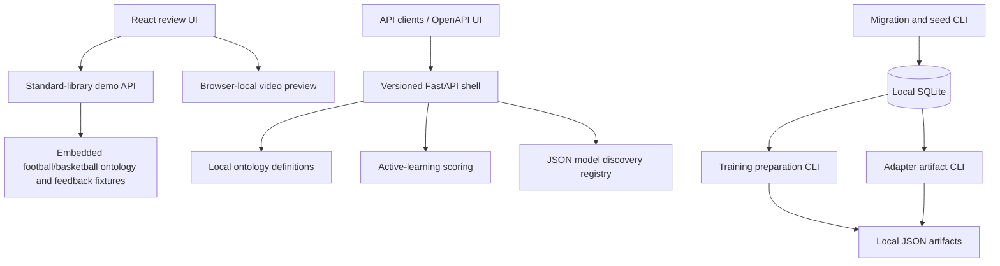

# Architecture

The repository is a Python/TypeScript monorepo for a local-first labelling
prototype. Shared ontology and provenance contracts connect its design. The
implementation has three independently usable paths.

## Current runtime paths

The demo API uses shared contracts and embedded football/basketball ontology
fixtures from `packages/ontology/examples.py`. It does not use SQLite. The FastAPI shell likewise does not persist uploads, predictions or
corrections; its discovery route does write the JSON model registry.
No pipeline orchestrator connects browser upload to media extraction,
evidence fusion, persistent review and training.

## API boundaries

| Entry point | Role | Route shape |
| --- | --- | --- |
| `apps.api.server` | Dependency-free server consumed by the React client | `/health`, `/api/...` |
| `apps.api.main:app` | FastAPI shell, OpenAPI, active-learning input scoring and model discovery | `/api/v1/...`, `/docs` |

Their request and response shapes differ. The demo mock endpoint returns a list
of up to three sparse prediction records; FastAPI returns a single prediction
at a requested integer timestamp. The frontend is wired to the demo server.
See [API reference](API_REFERENCE.md).

## Module boundaries

| Module | Input / output and responsibility |
| --- | --- |
| Ontology | Load and validate JSON labels; return new definitions for additive evolution |
| Ingestion | Plan rational timestamps; extract frames from local MP4 through FFmpeg |
| Extraction | Stateless `Extractor.extract(ExtractionRequest)` protocol; four mocks emit evidence |
| Fusion | Validate evidence and group populated one-second windows; report missing modalities |
| Labelling | Rank predictions for review with scoring reasons; general scoring/smoothing is unfinished |
| Contracts | Portable schemas and Python validation; frontend types are mirrored manually |
| Storage | SQLite connections, SQL migrations, development seed and relational constraints |
| Training | Read accepted, valid corrections; write manifests and versioned adapter JSON |
| Model registry | Candidate metadata discovery, synthetic smoke tests, scoring, recommendations and JSON persistence |
| Evaluation | Compare supplied predictions against references; recommend whether to promote |

The [source map](REPO_STRUCTURE.md) links each implementation.

## Intended integrated pipeline

This is the product direction, not an available end-to-end flow. Audio track
extraction, real extractors, general probabilistic labelling, smoothing,
persistent API integration, model weight training and promotion orchestration
are still gaps.

## Design constraints and provenance

- Label identities come from versioned ontologies. Football labels live in
  definition files or demo data fixtures, not generic inference logic.
- Prediction contracts describe one-second intervals with evidence and model /
  ontology versions. Fusion emits only populated windows, and the demo timeline
  intentionally has gaps; full-video contiguous coverage is a future goal.
- Corrections retain source prediction snapshots rather than overwriting
  model-authored records. Reviewer authority, validity and trust determine
  training eligibility; model agreement alone is insufficient.
- Core extraction, fusion, scoring and evaluation operate on supplied data.
  Persistence is explicit in storage, registry and artifact tooling.
- Missing modalities are reported by fusion without invented evidence. Queue
  scoring can flag transition conflicts; this is not a complete temporal policy
  engine for accepting corrections.
- There are no mandatory cloud storage or remote inference dependencies.
  Optional Hugging Face discovery fetches public model metadata only.

## Operational boundary

Run development servers on loopback. The demo server allows all CORS origins;
FastAPI has no configured CORS middleware or authentication. Its `admin` route
name does not enforce an administrator role, and discovery accepts a
caller-specified registry path. These are local development interfaces.
Public source publication does not deploy APIs or expose local data.
